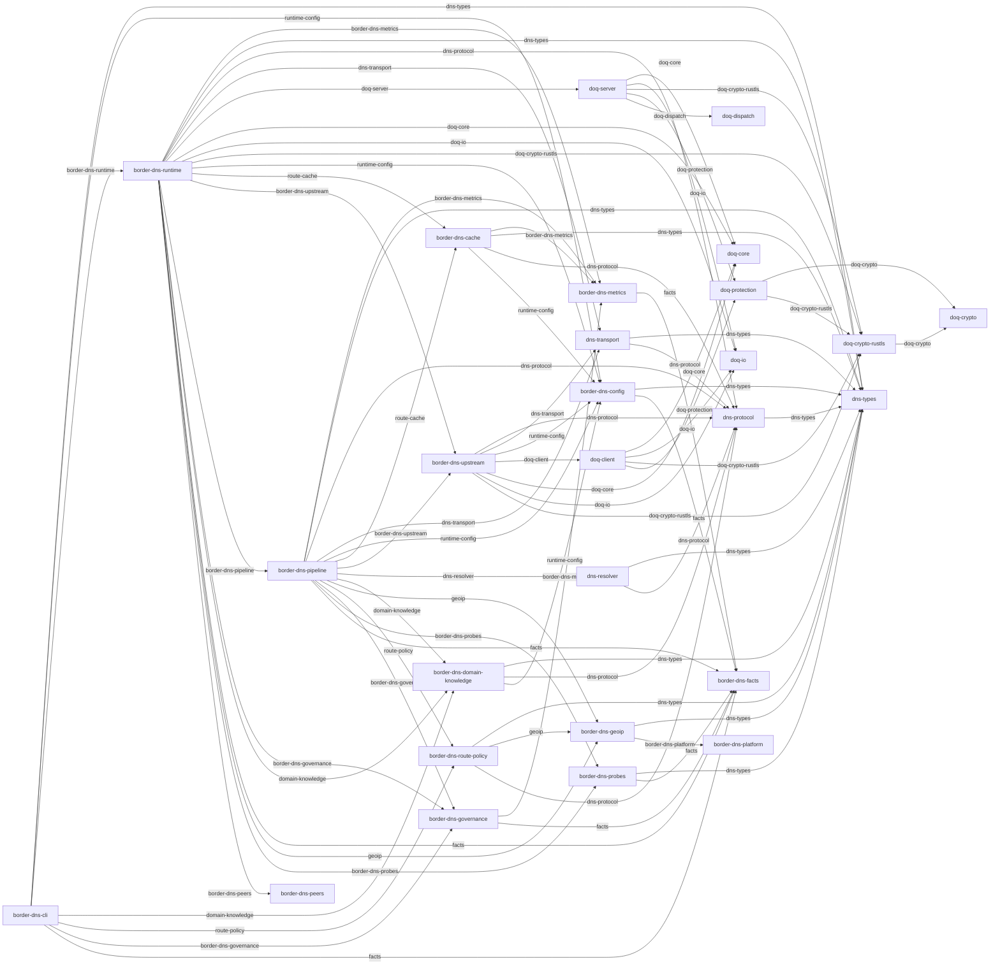

# BorderDNS

BorderDNS is a high-performance DNS runtime with a **facts-aware domain governance loop**.

---

## 1. Product Identity

BorderDNS consists of:

```text
DNS Runtime
    +
Facts-aware Domain Governance Loop
```


## Data Flow

```mermaid 
flowchart LR
  admin("Read-only admin snapshots")
  authority["Authoritative DNS servers"]
  backend("Pipeline backend: forwarding / recursive")
  cache[("Route-scoped answer cache (memory)")]
  client["DNS client"]
  diagnostic("Gated explicit DNS diagnostic POST")
  facts[("Facts JSONL and manifest")]
  ingress("Authenticated peer observation ingress")
  latency("Location-scoped latency worker")
  maintenance("Governance maintenance")
  measurements[("Latency read model (memory)")]
  observe("Bounded TLS and third-party observation")
  operator["Operator / dashboard"]
  peer["Authenticated observer peers"]
  recent[("Bounded recent facts read model")]
  reduce("Reducer + ordered local evidence worker")
  refresh("Bounded cache refresh")
  resolve("Shared DNS pipeline: parse, route, cache, shape")
  serve("Transport admission and response encoding")
  state[("Governance state (memory + durable journal)")]
  targets["TLS and TCP probe targets"]
  telemetry[("Typed metrics and runtime feedback")]
  upstream["Forward DNS upstreams"]
  writer("Batched cold-path fact writer")
  client -->|"DNS request bytes"| serve
  serve -->|"DNS response bytes; UDP size handling"| client
  upstream -->|"Forward DNS response"| backend
  backend -->|"Iterative DNS query via resolver"| authority
  authority -->|"Authoritative DNS response"| backend
  resolve -->|"EvidenceEnvelope via bounded try_send"| reduce
  resolve -->|"ObservationTask via bounded try_send"| observe
  observe -->|"Bounded TLS identity probe"| targets
  targets -->|"TLS identity result"| observe
  observe -->|"Authenticated snapshot fetch"| peer
  peer -->|"Validated third-party snapshot"| observe
  observe -->|"Normalized TLS or third-party evidence"| reduce
  serve -->|"Admitted request and RequestMeta"| resolve
  reduce -->|"Reducer-owned state transition and journal"| state
  state -->|"Versioned state"| reduce
  reduce -->|"BorderDnsFactEvent via bounded queue"| writer
  writer -->|"Batch append outside request path"| facts
  writer -->|"Projected recent facts; not durable receipt"| recent
  resolve -->|"Eligible LatencyProbeBatch via bounded try_send"| latency
  latency -->|"TCP connect to location-eligible IP"| targets
  targets -->|"Connect latency or failure"| latency
  latency -->|"Successful latency samples"| measurements
  measurements -->|"Answer ordering only; never route authority"| resolve
  resolve -->|"PipelineResponse and EDNS budget"| serve
  resolve -->|"Typed execution metrics and feedback"| telemetry
  operator -->|"Snapshot GET and filters"| admin
  state -->|"Governance snapshot"| admin
  cache -->|"Cache snapshot"| admin
  telemetry -->|"Metrics and feedback snapshot"| admin
  recent -->|"Retained recent fact rows"| admin
  admin -->|"Read-only dashboard DTOs"| operator
  operator -->|"Loopback gated POST domain and qtype"| diagnostic
  diagnostic -->|"Canonical FQDN; private + global admission"| resolve
  resolve -->|"Served result and QueryExecution"| diagnostic
  state -->|"Recorded attribution for future query route"| resolve
  diagnostic -->|"Diagnostic DNS result or HTTP error"| operator
  peer -->|"Authenticated observation request"| ingress
  ingress -->|"Validated evidence via shared bounded queue"| reduce
  state -->|"Lifecycle candidates"| maintenance
  maintenance -->|"MaintenanceEvidence"| reduce
  cache -->|"Due refresh candidates"| refresh
  refresh -->|"Background refresh through pipeline-owned API"| resolve
  resolve -->|"Route-scoped lookup and insert"| cache
  cache -->|"Cached DNS answer or miss"| resolve
  resolve -->|"Cache miss; frozen route and query"| backend
  backend -->|"ResolutionResponse with explicit source"| resolve
  backend -->|"Forward DNS query; selected group(s)"| upstream
```



---

## UML Components


